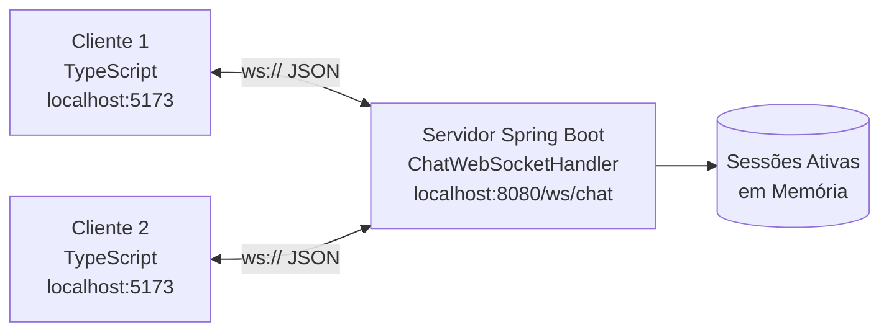

# Nem te conto... 👀

Aplicação de chat em tempo real com protocolo **WebSocket nativo (`ws://`)**, backend em **Spring Boot (Java)** e frontend em **TypeScript (Vite)**. Demonstra comunicação bidirecional contínua (*full-duplex*) e *broadcast* entre múltiplos clientes simultâneos.

## Requisitos

| Requisito | Implementação |
| --- | --- |
| Protocolo WebSocket (`ws://`) | Spring WebSocket puro (`@EnableWebSocket`, sem STOMP/SockJS) e API `WebSocket` do navegador |
| Endpoint | `ws://localhost:8080/ws/chat` |
| Múltiplos clientes | Sessões simultâneas em memória via `ConcurrentHashMap.newKeySet()` |
| Envio e broadcast | Cliente envia JSON via `ws.send()`; servidor reenvia para todas as sessões abertas |
| Interface web | SPA em HTML5 + TypeScript + Tailwind CSS em `frontend/` |
| Logs no servidor | Registro no console para abertura, recebimento de mensagem e encerramento |

## Arquitetura



- **Backend**: Endpoint `/ws/chat` configurado em `WebSocketConfig` e gerenciado por `ChatWebSocketHandler`.
- **Frontend**: Classe `ChatWebSocket` (`src/websocket.ts`) com API nativa do navegador e reconexão automática.
- **Mensagens**: Objetos JSON (`id`, `type`, `data`, `sender`, `timestamp`) trafegados em frames de texto.

## Decisões de Projeto

| Decisão | Solução Adotada |
| --- | --- |
| **Identificação dos clientes** | `session.getId()` do Spring nos logs do servidor; campo `sender` (padrão `"Anônimo"`) e `id` único gerado no cliente para exibir mensagens sem duplicação. |
| **Armazenamento de conexões** | `Set<WebSocketSession>` via `ConcurrentHashMap.newKeySet()` em memória, garantindo acesso *thread-safe*. |
| **Clientes desconectados** | Remoção em `afterConnectionClosed`, limpeza de sessões fechadas e `try/catch` individual no `broadcast()`; frontend tenta reconectar até 5 vezes (a cada 3s). |
| **Formato das mensagens** | **JSON** (`TextMessage`), permitindo estruturar conteúdo, remetente, tipo e timestamp. |

## Ciclo de Vida da Conexão

1. **Abertura**: O frontend cria `new WebSocket("ws://localhost:8080/ws/chat")`. Após o handshake HTTP (`101 Switching Protocols`), o backend executa `afterConnectionEstablished()`, armazena a sessão e registra `Conexão aberta` no log; o cliente dispara `onopen` e exibe **Conectado**.
2. **Envio**: Ao enviar uma mensagem, `ChatApp.sendMessage()` renderiza localmente (`isOwn: true`) e chama `ws.send()` enviando o JSON pelo socket aberto.
3. **Recebimento e Broadcast**: `ChatWebSocketHandler.handleTextMessage()` registra o payload no log e chama `broadcast()`, enviando a mensagem para todas as sessões abertas. No frontend, `onmessage` exibe a mensagem recebida (ignorando duplicatas pelo `id`).
4. **Encerramento**: Ao fechar a aba ou perder conexão, o backend executa `afterConnectionClosed()`, remove a sessão e registra `Conexão encerrada`; o frontend dispara `onclose`, atualiza o status para **Desconectado** e tenta reconectar.

## Tecnologias

Java 25, Spring Boot 4.1.3, Spring WebSocket, Maven, TypeScript 5.1.6, Vite 4.4.9, Tailwind CSS 3.3.3, Docker Compose.

## Execução

### Pré-requisitos

Docker e Docker Compose, ou:
- Java 25 (JDK)
- Node.js 20+ e npm (ou pnpm)

### Opção 1: Com Docker Compose (recomendado)

```bash
# Subir backend (8080) e frontend (5173)
docker compose up -d --build

# Acompanhar logs do servidor WebSocket
docker compose logs -f backend

# Encerrar
docker compose down
```

Acesse o chat em `http://localhost:5173`.

### Opção 2: Localmente (sem Docker)

Terminal 1 — Backend (Spring Boot):
```bash
cd backend
./mvnw spring-boot:run
```

Terminal 2 — Frontend (TypeScript + Vite):
```bash
cd frontend
npm install
npm run build      # Compila TypeScript (tsc) e gera o bundle (vite build)
npm run dev        # Ou use 'npm run preview' para servir o build gerado
```

Acesse `http://localhost:5173` no navegador.

> Por padrão, o frontend conecta em `ws://localhost:8080/ws/chat` (configurável via `VITE_WS_URL`).

## Testes

### Teste Manual (Múltiplos Clientes)

1. Abra `http://localhost:5173` em **duas ou mais abas** e confirme o status **Conectado**.
2. Envie mensagens com nomes diferentes e observe o *broadcast* instantâneo entre as abas.
3. Verifique no console do backend os logs de abertura, recebimento de mensagem e encerramento ao fechar uma aba.

## Estrutura do Repositório

```text
chat-websocket/
├── backend/
│   ├── Dockerfile
│   ├── mvnw
│   ├── pom.xml
│   └── src/
│       ├── main/java/br/projeto/chat_ws/
│       │   ├── ChatWsApplication.java
│       │   ├── config/WebSocketConfig.java          # Rota /ws/chat
│       │   └── handler/ChatWebSocketHandler.java    # Ciclo de vida e broadcast
│       └── test/java/br/projeto/chat_ws/
│           └── WebSocketConfigIntegrationTest.java  # Teste com 2 clientes
├── frontend/
│   ├── Dockerfile
│   ├── index.html
│   ├── package.json
│   └── src/
│       ├── main.ts                                  # Interface e eventos
│       ├── websocket.ts                             # Cliente WebSocket nativo
│       ├── types.ts
│       └── utils.ts
├── docker-compose.yml
└── README.md
```
